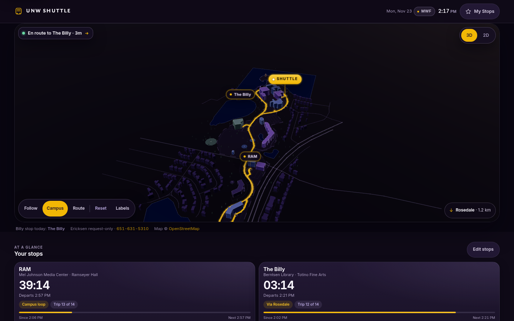

# UNW Shuttle

A map-first shuttle dashboard for the University of Northwestern – St. Paul.
Read the next departure at a glance, follow the bus on the 2026 campus map, and
keep only the stops you actually use.

[](https://henrygetz.github.io/unw-shuttle/)

The point is simple: when it is 10°F outside, you should not have to guess when
the next bus reaches your stop. Open the page, read the timer, leave at the
right minute.

## What it does

- **Your stops first.** RAM and The Billy start pinned, so a first visit has
  countdowns immediately. Pick 1–3 stops or use a preset such as Dorm ↔ Main
  Campus, Commuter / Rosedale, or Fine Arts / Library. Pins persist in
  `localStorage`; the My Stops sheet lets you add, remove, and reorder them at
  any time.
- **A map-first layout.** The 3D campus diorama (or the always-available 2D
  map) is the hero on desktop and mobile. Pinned countdowns sit directly below
  the map, not after two screens of cards. On desktop the 2D map uses a
  north/south atlas so stop labels stay legible without zooming.
- **A real timetable, honestly presented.** MWF, Tue–Thu, and finals service;
  the published route variants; request-only Ericksen; the final drop-off-only
  trip. The bus is a schedule simulation, not live GPS.
- **Finals, weekends, and breaks.** The service calendar switches to the finals
  stop and explains why there is no daytime bus during recesses.
- **Campus time, not browser time.** Every schedule calculation runs in
  `America/Chicago`, so the dashboard stays correct on a laptop set to another
  zone.
- **No backend, no API keys, no runtime network calls.** Timetable, campus
  geometry, and fonts are baked into the static build and deployed to GitHub
  Pages.

## Run it

Requires Node 22+ and pnpm 10.

```bash
pnpm install
pnpm dev        # http://localhost:5180
pnpm test       # schedule and preference tests
pnpm build      # static build in dist/
pnpm preview    # serve the production build
```

## Personalization

The first-visit onboarding is skippable. Its state lives under one versioned
key:

```text
unw_shuttle_prefs_v1
{
  version: 1,
  onboarded: boolean,
  pinnedStops: StopId[],       // 1–3 unique published stops
  viewMode: "3d" | "2d",
  defaultCamera: "follow" | "campus" | "route"
}
```

With no pins, the dashboard shows the next departure across all stops and a
one-tap path to pick stops. Ericksen is request-only, so pinning or selecting it
surfaces a `Call Public Safety · 651-631-5310` action. The app never invents a
live vehicle position.

## Schedule sources

The schedule was captured on **2026-11-23** from myUNW → Public Safety →
Shuttle Schedule. The page itself says it was **updated 2026-10-12**. The finals
timetable comes from the linked **Spring 2024** finals PDF.

| App label | Physical stop | Source column |
| --- | --- | --- |
| RAM | MJMC / Ramseyer Hall | Ramseyer |
| Akenson | Akenson Hall | Akenson |
| Rosedale | Rosedale Square (off campus) | Rosedale |
| Lower Riley | Lower Riley parking lot | Lower Riley |
| The Billy (regular) | Berntsen Library / Totino Fine Arts | BRC / Totino |
| The Billy (finals) | Graham Commons | Graham |
| Ericksen | Ericksen Center | Ericksen (request only) |

Source caveats reflected in the app:

- There is no Wilson Center stop in the published timetable. Wilson Center is
  still mapped as an official campus building.
- Ericksen is request-only. Call **651-631-5310**.
- Public Safety's page says the shuttle does not operate during breaks,
  holidays, or chapel. The published table still lists mid-morning trips, so
  the app follows the table; confirm with Public Safety if a chapel-time trip
  matters.
- The final regular trip and the final finals trip end with a **drop-off only**
  at BRC / Totino. There is no published departure time for that leg, so the
  moving map estimates its arrival at +2 minutes. The countdowns never invent a
  departure for it.
- The finals PDF prints the 11:00 row as **11:00 PM**. The surrounding rows are
  10:15 AM and 12:32 PM, so the app uses **11:00 AM** and flags the correction.
- The evening shuttle runs **6:00 PM–12:00 AM** but has no timetable on the
  page. The app shows the window as a note and does not count down to it.

The academic calendar drives closures and finals. It is in
`src/data/calendar.ts`, currently covering through **2027-03-29**. Update that
file when the next academic year is published.

This is an unofficial project. It is not affiliated with UNW or Public Safety.
Schedules can change; verify with the university before relying on a trip.

## Campus map and brand

The 2026 campus map (`docs/2026_CampusMap_BuildingLocation.pdf`) is the source
for the 21 official building numbers, names, categories, and the Lake Johanna /
Little Lake Johanna / Island Chapel context. The app uses that metadata to
categorize the OSM building footprints and labels:

- academic/admin: royal plum/violet-slate
- housing/residential: twilight steel-indigo
- athletic: deep sage
- water: dark reflective indigo

The shuttle route uses Northwestern Gold for the active loop and restrained
lavender for the inactive loop. Building footprints and campus features come
from OpenStreetMap; the official PDF is a stylized reference, not a
geo-referenced tracing. The custom display face in
`src/assets/fonts/unw-font.woff2` is registered as `UNW Display` and is reserved
for the brand wordmark and high-impact titles.

Stop labels use a screen-space collision solver with leader stems: the live
shuttle has first priority, pinned/selected stops second, and unpinned stops
last. The labels are checked at desktop and phone widths across Follow, Campus,
and Whole Route views.

## How it works

```text
src/data/schedule.ts        published trips, MWF / Tue–Thu / finals
src/data/calendar.ts        closures and finals windows
src/data/officialMap.ts     2026 PDF building numbers, categories, aliases
src/data/route.json         smoothed route variants + stop distances
src/data/campus.json        OSM buildings, roads, water, campus boundary
        │
        ▼
src/lib/schedule.ts         pure engine: service day, departures, next service,
                            bus phase, position along the route
src/lib/prefs.ts            versioned localStorage store (pins, view, camera)
src/lib/time.ts             America/Chicago wall clock and formatting
        │
        ├── src/components/  map-first shell, onboarding, pinned cards, timetable
        └── src/scene/       Three.js campus, route, animated bus, label solver
```

- `MWF` and `Tue/Thu` are separate published timetables.
- A trip with a Rosedale time uses the **via** route. A trip without it uses the
  **bypass** route.
- `busStateAt(now)` returns one of `in-service`, `returning`, `parked`, or `off`.
  Between trips the bus is animated back to Ramseyer; the return leg is not a
  published trip and never affects a countdown.
- The map geometry is baked. There is no Overpass/OSRM call at runtime.
- The 2D SVG map and the 3D scene read the same route and campus JSON.
- The 3D scene is lazy-loaded; the countdowns and the 2D map paint before the
  Three.js chunk arrives.

## Tests

`pnpm test` covers the engine and the personalization contract:

- service-day selection across MWF, Tue/Thu, finals, weekends, and closures;
- trip counts, monotonic stop times, via/bypass selection;
- the finals 11:00 PM typo correction;
- countdowns, next-service rollover, finals Billy stop;
- bus phases, return-to-Ramseyer behavior, and route geometry;
- preference normalization, pin limits, and preset validity.

The UI, onboarding, 2D mode, collision-free labels, and responsive layouts are
also verified in Chromium with a real WebGL context at desktop and phone
viewports.

## Deploy

Pushing to `main` runs `.github/workflows/deploy.yml`, which tests, builds, and
publishes `dist/` to GitHub Pages. Vite `base` is `./`, so the same build works
at `/unw-shuttle/` and locally.

If Pages is not enabled yet: repository **Settings → Pages → Build and
deployment → Source: GitHub Actions**.

## Credits

- Schedule: University of Northwestern – St. Paul, Public Safety.
- Campus map and official building metadata: UNW 2026 Campus Map
  (`docs/2026_CampusMap_BuildingLocation.pdf`).
- Campus map data: © OpenStreetMap contributors, available under the
  [Open Database License](https://opendatacommons.org/licenses/odbl/).
- Route geometry: generated once with OSRM from the published stop list; the
  app makes no routing requests at runtime.

## License

MIT. Schedule and campus-map data belong to the university; the app is an
independent, unofficial interface to publicly posted information.
